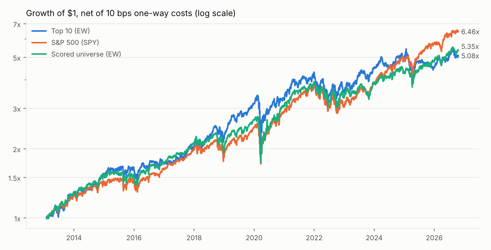
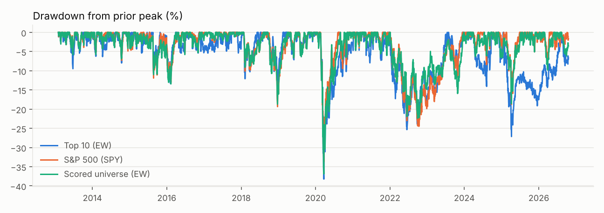
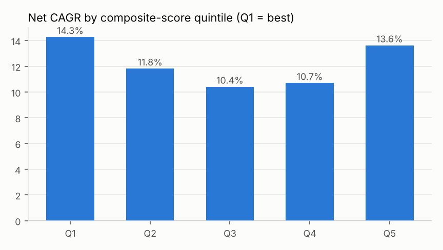
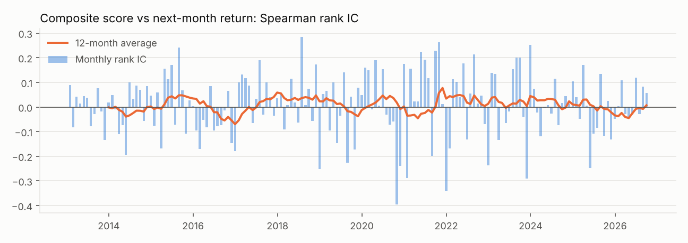

# WIC-S003 Walk-Forward Backtest — sp500_2026-10-19__backtest__cfgbddebc2e350e

Monthly rebalance 2013-01-31 → 2026-10-19 (returns through 2026-10-19), 166 rebalances, equal-weight books, 10 bps one-way transaction cost on traded notional.

**Model weights and factor definitions were fixed by the September 2026 specification before this test and were not tuned on it.** This is a historical simulation, not a forecast.

## Performance (net of costs)

| Portfolio | CAGR | Vol | Sharpe | Max DD | Beta | Alpha (ann.) | Alpha t (HAC) | IR vs SPY | Turnover/mo |
|---|---:|---:|---:|---:|---:|---:|---:|---:|---:|
| Top 10 (EW) | 12.6% | 18.7% | 0.63 | -38.2% | 0.92 | -0.4% | -0.17 | -0.14 | 31% |
| Top 10 sector-capped | 12.5% | 18.4% | 0.63 | -38.5% | 0.92 | -0.5% | -0.21 | -0.15 | 31% |
| Top 20 (EW) | 14.2% | 17.7% | 0.74 | -39.9% | 0.94 | 0.7% | 0.31 | -0.02 | 26% |
| Q1 | 14.3% | 16.8% | 0.77 | -36.1% | 0.93 | 0.6% | 0.39 | -0.04 | 23% |
| Q2 | 11.8% | 16.5% | 0.65 | -37.3% | 0.92 | -1.4% | -0.89 | -0.41 | 41% |
| Q3 | 10.4% | 16.5% | 0.57 | -31.2% | 0.91 | -2.5% | -1.51 | -0.57 | 43% |
| Q4 | 10.7% | 17.2% | 0.57 | -36.6% | 0.94 | -2.6% | -1.41 | -0.48 | 36% |
| Q5 | 13.6% | 20.8% | 0.63 | -44.0% | 1.07 | -1.0% | -0.36 | -0.01 | 19% |
| Scored universe (EW) | 13.0% | 16.9% | 0.70 | -36.9% | 0.95 | -0.7% | -0.51 | -0.25 | 5% |
| All PIT members w/ prices (EW) | 12.8% | 17.3% | 0.68 | -39.7% | 0.97 | -1.2% | -0.73 | -0.26 | 3% |
| S&P 500 (SPY) | 14.6% | 16.8% | 0.79 | -33.7% | 1.00 | — | — | — | — |
| S&P 500 equal weight (RSP) | 12.0% | 17.2% | 0.64 | -39.0% | 1.00 | — | — | — | — |

Quintile monotonic (Q1 ≥ Q2 ≥ … ≥ Q5 by CAGR): **False**

## Top 10 vs the scored universe (same survivorship exposure)

- Excess CAGR -0.4%, tracking error 9.8%, IR -0.01, monthly hit rate 50%, monthly active-return t-stat (HAC) -0.16.
- This comparison is the most robust read: both legs draw from the same point-in-time, price-available universe, so the survivorship gap affects them alike.

## Signal quality: rank information coefficients (next-month total return)

| Signal | Mean IC | IC IR | t-stat | % months > 0 |
|---|---:|---:|---:|---:|
| composite | 0.009 | 0.07 | 0.93 | 57% |
| quality | 0.005 | 0.04 | 0.53 | 53% |
| valuation | 0.006 | 0.04 | 0.54 | 46% |
| growth | -0.003 | -0.03 | -0.35 | 45% |
| momentum | 0.008 | 0.05 | 0.59 | 58% |
| risk | 0.006 | 0.03 | 0.39 | 53% |
| roic_score | 0.005 | 0.05 | 0.62 | 55% |
| fcf_margin_score | 0.006 | 0.06 | 0.74 | 52% |
| net_debt_ebitda_score | -0.001 | -0.01 | -0.15 | 52% |
| fcf_yield_score | 0.008 | 0.06 | 0.79 | 48% |
| ev_ebit_score | 0.001 | 0.01 | 0.11 | 47% |
| revenue_cagr_3y_score | -0.004 | -0.04 | -0.48 | 47% |
| eps_cagr_3y_score | -0.000 | -0.00 | -0.00 | 47% |
| momentum_12_1_score | 0.005 | 0.03 | 0.34 | 54% |
| momentum_6_1_score | 0.010 | 0.06 | 0.80 | 53% |
| volatility_252_score | 0.003 | 0.02 | 0.21 | 51% |
| max_drawdown_252_score | 0.006 | 0.03 | 0.42 | 54% |

## Calendar-year returns (net)

| Year | Top 10 (EW) | Top 10 sector-capped | Scored universe (EW) | S&P 500 (SPY) |
|---|---:|---:|---:|---:|
| 2013 | 27.8% | 26.0% | 30.1% | 25.9% |
| 2014 | 20.1% | 21.1% | 18.2% | 13.5% |
| 2015 | 6.4% | 6.4% | -1.0% | 1.2% |
| 2016 | 4.7% | 2.6% | 12.9% | 12.0% |
| 2017 | 16.8% | 16.2% | 22.5% | 21.7% |
| 2018 | 13.5% | 11.5% | -4.1% | -4.6% |
| 2019 | 38.5% | 37.3% | 32.2% | 31.2% |
| 2020 | 5.2% | 6.2% | 16.1% | 18.3% |
| 2021 | 30.2% | 28.3% | 25.8% | 28.7% |
| 2022 | -18.1% | -17.0% | -13.7% | -18.2% |
| 2023 | 27.5% | 26.0% | 15.8% | 26.2% |
| 2024 | 7.5% | 8.1% | 9.6% | 24.9% |
| 2025 | -7.2% | -4.9% | 11.7% | 17.7% |
| 2026 | 13.2% | 15.4% | 12.1% | 13.3% |

## Data coverage per rebalance

- Average point-in-time members: 503; average complete 11-factor scores: 215.
- Average members with no obtainable price history (delisted/renamed tickers absent from Yahoo): 74.6 — see rebalance_coverage.csv.

## Method and controls

- Universe: S&P 500 membership on each rebalance date (fja05680/sp500 point-in-time list). GICS sector and CIK labels from the most recent Wikipedia revision on or before the date.
- Fundamentals: only SEC XBRL facts whose filing date is at least 1 day before the rebalance; restatements filed later are not visible.
- Prices: total-return (dividend + split adjusted) closes up to the rebalance close.
- Scoring: identical production code as the live screen (sector-relative, 20-peer minimum, 5/95 winsorization, midrank percentiles, all 11 factors required, no imputation).
- Execution: trades at the rebalance close; names that stop trading are held at last price (cash-like).

## Known limitations (read before quoting any number)

1. **Survivorship:** Yahoo Finance does not carry most delisted symbols, so members that were later acquired/bankrupt and lack price history are excluded from that month's universe. This biases absolute returns upward for every portfolio built from the universe; comparisons against the scored universe are less affected than comparisons against SPY.
2. **Ticker identity:** price histories are keyed by ticker; a recycled ticker could in rare cases attach another issuer's prices.
3. **Costs:** a flat cost assumption; no market impact, borrow or taxes. Long-only, no leverage.
4. **Sector labels** come from semiannual Wikipedia snapshots, so a reclassification is picked up with up to ~6 months delay.
5. Past simulated performance does not predict future returns. Ranks are research priorities, not orders.
